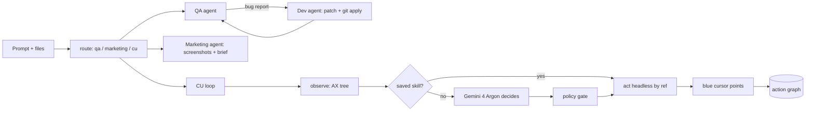

# ComputerAnything (MVP)

A macOS agent with its own blue cursor. It looks at your screen, answers out loud, and points at, circles or clicks things. The cursor idea comes from [Clicky](https://github.com/farzaa/clicky) (MIT).

## Setup

```sh
cp .env.example .env    # fill in the keys
./run.sh                # builds the overlay, then prompts for requests
```

| Variable | Needed for |
|---|---|
| `OPENROUTER_API_KEY` | the brain: `google/gemini-4-argon` via OpenRouter |
| `ELEVENLABS_API_KEY` | voice (TTS, `--voice` STT); without it, macOS `say` speaks |
| `ELEVENLABS_VOICE_ID` | optional voice choice |

Grant Screen Recording to your terminal. Clicks also need Accessibility.

## Demo

```sh
./run.sh
> where is the Wi-Fi menu?
> circle the close button of this window
```

One-off: `python3 agent.py "point at the search field"`, or `python3 agent.py --voice` to speak for 5 s (needs ffmpeg).

## How it works

1. `agent.py` takes a screenshot (`screencapture`, resized to 1280 px with `sips`) and sends it with the prompt to Gemini.
2. The model replies with a short answer plus tags: `[POINT:x,y:label]`, `[DRAW:circle|rect|arrow:x,y,w,h]`, `[HIGHLIGHT:x,y,w,h]`, `[CLICK:x,y]`.
3. Tags are scaled from screenshot pixels to screen points and written as JSON lines to `overlay/overlay`. That's a single-file Swift app: one transparent, click-through panel per screen.
4. Clicks only run after you answer `y` in the terminal.

Overlay protocol on stdin, top-left-origin screen points:

```json
{"op":"point","x":600,"y":400,"label":"Save"}
{"op":"draw","shape":"circle","x":550,"y":350,"w":200,"h":120}
{"op":"highlight","x":800,"y":300,"w":200,"h":80}
{"op":"click","x":600,"y":400}
```

Self-check without network: `python3 agent.py --selftest`.

Limits: main display only. Shapes fade after 4 s.

## Agent backend (`ca/`)

The backend turns one prompt into a pipeline of agents that drive real macOS apps. It runs with a bare test page; the product UI talks to the same HTTP API.

```sh
npm install -g agent-desktop     # accessibility-tree actions (vercel-labs/agent-desktop)
python3 -m ca.server             # prints http://127.0.0.1:8765/?t=TOKEN
```



| Module | Job |
|---|---|
| `llm.py` | Gemini 4 Argon via OpenRouter; `CA_MOCK=1` for offline runs |
| `desktop.py` | observe and act through the accessibility tree, without moving your pointer |
| `cu_agent.py` | the loop: replay memory, else ask Gemini; gate; act; verify "done" with a second call |
| `graph.py` | action-graph memory: screens, edges with P = (1+k)/(2+n), Dijkstra planner, saved skills |
| `orchestrator.py` | routing, QA to dev loop until the bug report is empty (max 5 rounds), marketing brief |
| `runs.py` | runs, live events, help requests (no answer in 5 min counts as deny), digest |
| `server.py` | HTTP API plus a bare test page |

### API for the UI

Every `/api` call needs the token, as header `X-CA-Token` or query `t=`. The server listens on 127.0.0.1 only.

| Call | Purpose |
|---|---|
| `POST /api/task` | JSON `{"prompt"}` or multipart with files; returns `{"run": id}` |
| `GET /api/runs` | all runs, newest first, with `parent` for child agents |
| `GET /api/runs/<id>?since=N` | events after N: `decide`, `act`, `memory`, `verify`, `help`, `bug_report`, `patch`, `result` |
| `GET /api/help` | pending help requests: `captcha`, `sign_in`, `money`, `destructive`, `clarify` |
| `POST /api/help/<id>` | `{"choice": "approve"}` (one of the request's options) |
| `GET /api/graph` | memory stats: screens, transitions, skills |

The finished parent run has `result.digest` with steps, seconds, memory-replayed steps, help count and model usage.

### Checks

```sh
python3 -m ca.desktop && python3 -m ca.graph && CA_HOME=/tmp/ca_t python3 -m ca.orchestrator
```

Measured on a Mac: Calculator "7 × 6" ran headless to 42. The second run of the same goal replayed all 4 clicks from memory with 1 model call instead of 5.
