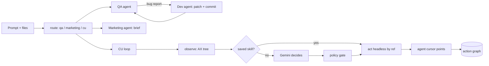
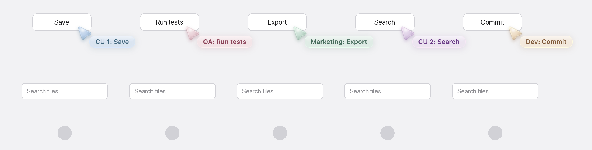
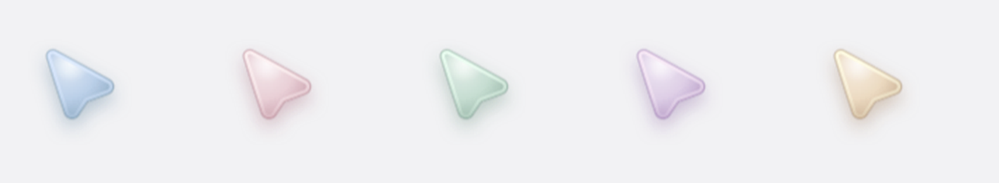
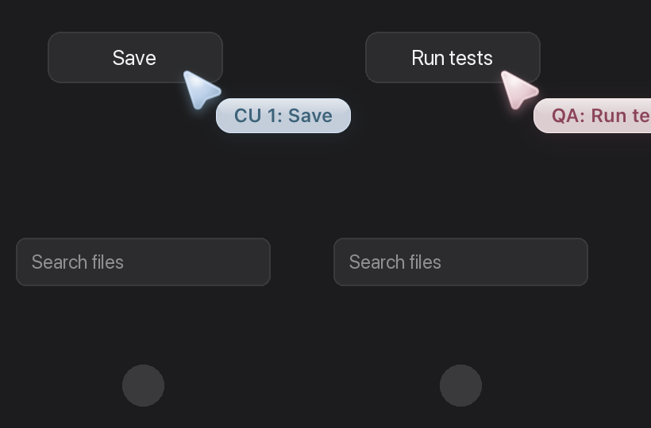

# ComputerAnything backend

One prompt in, a team of agents out. They drive real macOS apps through the accessibility tree, with a sea-glass cursor of their own, and they remember what worked.

## Powered by Gemini 4 Argon

Every judgment in the pipeline is a Gemini 4 Argon call (`google/gemini-4-argon` via OpenRouter):

| Where | What Gemini decides |
|---|---|
| `agents/orchestrator.py` `route` | which agent takes the prompt: QA, marketing or computer use |
| `cu/cu_agent.py` `_decide` | the next action on screen, from the element table plus a screenshot when needed |
| `cu/cu_agent.py` `_verify` | whether "done" is true, citing the on-screen values |
| `agents/orchestrator.py` QA | the bug report, from test output and a CU check of the running app |
| `agents/orchestrator.py` dev | the patch that fixes it; the commit credits Gemini |
| `agents/orchestrator.py` marketing | tagline, 60-second launch script, shot list, palette |
| `tools/point.py` | spoken answer plus point, draw, highlight tags for the cursor |

Code, not the model, decides what needs a person. That covers money, sign-in, captchas, destructive steps and patches.

## Layout

```
backend/
  computeranything/
    core/    llm.py (Gemini client), runs.py (runs, events, help requests, digest)
    cu/      desktop.py (observe/act), apps.py (open, wait, place), desk.py (sharing rules),
             cu_agent.py (loop), graph.py (memory), overlay.py (cursors)
    agents/  orchestrator.py (routing, QA to dev loop, marketing, CU)
    api/     server.py (HTTP API + test page)
    tools/   point.py (one-shot: ask about the screen, cursor points)
  overlay/   Overlay.swift (transparent click-through layer, one cursor per agent)
  scripts/   point_repl.sh
```



## Run

```sh
npm install -g agent-desktop          # accessibility-tree actions (vercel-labs/agent-desktop)
cp .env.example .env                  # OPENROUTER_API_KEY, optional ELEVENLABS_API_KEY
python3 -m computeranything           # prints http://127.0.0.1:8765/?t=TOKEN
```

Grant your terminal Accessibility and Screen Recording. Actions run headless by element ref, so your own pointer and focus stay put.

## Memory

Each app gets a state graph. A screen is a node, keyed by app, window title and its element labels. Two visits with label-set Jaccard of 0.8 or more count as one node, so a changing clock doesn't split a screen.

An edge is an action from a screen. With $n$ tries and $k$ successes, its reliability is

$$P = \frac{1+k}{2+n}$$

the Beta(1,1) posterior mean. After 2 successes in 2 tries, $P = 3/4$. The planner runs Dijkstra on edge cost $-\log P + 0.05\,t$, where $t$ is the median latency in seconds, and never routes through send, pay or delete edges.

A successful run is saved as a skill. The same goal later replays by element label without a model call.

Every action by every agent is logged against its screen node: the agent, run, app and source (memory or Gemini), the screen it led to, latency, and one outcome of `ok`, `failed`, `denied`, `help`, `done_verified` or `done_rejected`. The full history is append-only in `~/.computeranything/actions.jsonl`. Only executed actions (`ok`, `failed`) move $P$, so a person saying no never makes a button look unreliable.

## Many agents, many cursors

A prompt with independent parts, such as "work out 7 × 6 in Calculator and open Appearance settings", becomes up to 4 CU agents running in parallel. Each agent claims its own cursor with its own color and name tag (`CU 1`, `CU 2`, `QA`, `Marketing`). Its clicks run headless, so the agents never fight over your one real pointer.



Each cursor is a domed glass pointer lit from above, in one of five palettes (lagoon, rose, mint, lilac, amber; after [sea-glass](https://github.com/mttmcknn/sea-glass)). Its frosted pill carries the agent's name and current target. Targets get a see-through glass bubble in the agent's colour instead of a box: `highlight` tints it more, `draw` less. The bubble springs into place and fades after two seconds, and its shadow is cleared inside so the button under it stays readable. With Reduce Motion on, cursors fade in place instead of flying.

| | |
|---|---|
|  |  |

Re-shoot with `python3 scripts/shoot_overlay.py`: it captures the overlay window alone and composites it on mock light and dark UIs, so none of your screen is in the images.

Measured on a Mac: two agents ran at once, one in Calculator (7 × 6 = 42) and one in System Settings (opened Appearance). All 7 of their actions landed in one shared graph, each tagged with its agent.

## Opening apps and sharing the screen

Agents open apps the way a person does. An agent reuses a running window, or finds the `.app` on disk and opens it, or presses cmd+space and types the name into Spotlight. It then waits until a visible window answers with accessibility elements, and only then starts working. Gemini can ask for another app mid-task with `open_app` and pick `spotlight` or `finder`.

Agents share one Mac through the desk (`cu/desk.py`):

| Rule | Why |
|---|---|
| One foreground at a time | only the lock holder may use Spotlight, activate a window or press physical keys; clicks by ref stay headless, so the others keep working |
| One agent per app | an app lease stops two agents from driving the same window |
| One lane per agent | each agent's window is placed in its own tile on the stage display (`CA_STAGE_DISPLAY`, default the secondary screen), so bringing one forward never covers another |
| Pinned window | each agent reads and acts only on its own window id |

`run_applescript` lets Gemini script an app on purpose. The script is logged in the graph. Scripts that contain `do shell script`, delete, send, pay or password steps wait for your approval. Text that is data, such as app names and typed words, is always passed to AppleScript as an argument, so words read off a web page can't turn into code.

Measured live with Gemini 4 Argon:

| Run | Result |
|---|---|
| Calculator "23 × 19", stale 42 on screen | cleared it, entered 23 × 19, read 437; 9 actions logged, 9 model calls, about 3.8 s per decision |
| Font Book via Spotlight | usable 6.1 s after Return; placed at its lane, 940 × 1018 |
| Calculator + System Settings in parallel | two lanes side by side on the external display, two cursors, no overlap |

Measured on a Mac: Calculator "7 × 6" ran headless to 42. The second run replayed all 4 clicks from memory, using 1 model call instead of 5 (only the "done" check).

## API for the UI

Every `/api` call needs the token, as header `X-CA-Token` or query `t=`. The server listens on 127.0.0.1 only.

| Call | Purpose |
|---|---|
| `POST /api/task` | JSON `{"prompt"}` or multipart with files; returns `{"run": id}` |
| `GET /api/runs` | all runs, newest first; child agents carry `parent` |
| `GET /api/runs/<id>?since=N` | events after N: `decide`, `act`, `memory`, `verify`, `help`, `bug_report`, `patch`, `commit`, `result` |
| `GET /api/help` | pending help: `captcha`, `sign_in`, `money`, `destructive`, `clarify` |
| `POST /api/help/<id>` | `{"choice": "approve"}`, one of the request's options; no answer in 5 min counts as deny |
| `GET /api/graph` | memory stats: screens, transitions, skills, actions logged, agents |
| `GET /api/actions?since=N&agent=CU%201` | the graph's action log, optionally for one agent |
| `GET /api/agents` | live cursors: agent id, name and color |

A finished parent run has `result.digest`: steps, seconds, steps replayed from memory, help count and model usage.

## Settings

| Variable | Default | Effect |
|---|---|---|
| `CA_MODEL` | `google/gemini-4-argon` | model id on OpenRouter |
| `CA_CONFIRM_PATCH` | `1` | ask before applying a dev-agent patch |
| `CA_DEV_COMMIT` | `1` | commit applied patches in the target repo |
| `CA_HOME` | `~/.computeranything` | runs, memory, uploads |
| `CA_MOCK` | unset | `1` runs everything offline with a scripted model |

## Checks

```sh
python3 -m computeranything.cu.desktop
python3 -m computeranything.cu.graph
CA_HOME=/tmp/ca_t python3 -m computeranything.agents.orchestrator
python3 -m computeranything.tools.point --selftest
ruff check computeranything
```

## One-shot cursor tool

`scripts/point_repl.sh` starts the overlay and answers questions about the screen out loud. The cursor points, circles or highlights, and clicks only after a `y`. Example: `> circle the close button of this window`.

The cursor idea comes from [Clicky](https://github.com/farzaa/clicky) (MIT).
