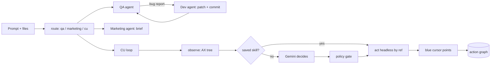

# ComputerAnything backend

One prompt in, a team of agents out. They drive real macOS apps through the accessibility tree, with a blue cursor of their own, and they remember what worked.

## Powered by Gemini 4 Argon

Every judgment in the pipeline is a Gemini 4 Argon call (`google/gemini-4-argon` via OpenRouter):

| Where | What Gemini decides |
|---|---|
| `agents/orchestrator.py` `route` | which agent takes the prompt: QA, marketing or computer use |
| `cu/cu_agent.py` `_decide` | the next action on screen, from the element table plus a screenshot when needed |
| `cu/cu_agent.py` `_verify` | whether "done" is true, citing the on-screen values |
| `agents/orchestrator.py` QA | the bug report, from test output and a CU check of the running app |
| `agents/orchestrator.py` dev | the patch that fixes it; the commit credits Gemini |
| `agents/orchestrator.py` marketing | tagline, 60-second launch script, shot list, palette |
| `tools/point.py` | spoken answer plus point, draw, highlight tags for the cursor |

Code, not the model, decides what needs a person. That covers money, sign-in, captchas, destructive steps and patches.

## Layout

```
backend/
  computeranything/
    core/    llm.py (Gemini client), runs.py (runs, events, help requests, digest)
    cu/      desktop.py (observe/act), cu_agent.py (loop), graph.py (memory), overlay.py (cursor)
    agents/  orchestrator.py (routing, QA to dev loop, marketing, CU)
    api/     server.py (HTTP API + test page)
    tools/   point.py (one-shot: ask about the screen, cursor points)
  overlay/   Overlay.swift (transparent click-through cursor layer)
  scripts/   point_repl.sh
```



## Run

```sh
npm install -g agent-desktop          # accessibility-tree actions (vercel-labs/agent-desktop)
cp .env.example .env                  # OPENROUTER_API_KEY, optional ELEVENLABS_API_KEY
python3 -m computeranything           # prints http://127.0.0.1:8765/?t=TOKEN
```

Grant your terminal Accessibility and Screen Recording. Actions run headless by element ref, so your own pointer and focus stay put.

## Memory

Each app gets a state graph. A screen is a node, keyed by app, window title and its element labels. Two visits with label-set Jaccard of 0.8 or more count as one node, so a changing clock doesn't split a screen.

An edge is an action from a screen. With $n$ tries and $k$ successes, its reliability is

$$P = \frac{1+k}{2+n}$$

the Beta(1,1) posterior mean. After 2 successes in 2 tries, $P = 3/4$. The planner runs Dijkstra on edge cost $-\log P + 0.05\,t$, where $t$ is the median latency in seconds, and never routes through send, pay or delete edges.

A successful run is saved as a skill. The same goal later replays by element label without a model call.

Measured on a Mac: Calculator "7 × 6" ran headless to 42. The second run replayed all 4 clicks from memory, using 1 model call instead of 5 (only the "done" check).

## API for the UI

Every `/api` call needs the token, as header `X-CA-Token` or query `t=`. The server listens on 127.0.0.1 only.

| Call | Purpose |
|---|---|
| `POST /api/task` | JSON `{"prompt"}` or multipart with files; returns `{"run": id}` |
| `GET /api/runs` | all runs, newest first; child agents carry `parent` |
| `GET /api/runs/<id>?since=N` | events after N: `decide`, `act`, `memory`, `verify`, `help`, `bug_report`, `patch`, `commit`, `result` |
| `GET /api/help` | pending help: `captcha`, `sign_in`, `money`, `destructive`, `clarify` |
| `POST /api/help/<id>` | `{"choice": "approve"}`, one of the request's options; no answer in 5 min counts as deny |
| `GET /api/graph` | memory stats: screens, transitions, skills |

A finished parent run has `result.digest`: steps, seconds, steps replayed from memory, help count and model usage.

## Settings

| Variable | Default | Effect |
|---|---|---|
| `CA_MODEL` | `google/gemini-4-argon` | model id on OpenRouter |
| `CA_CONFIRM_PATCH` | `1` | ask before applying a dev-agent patch |
| `CA_DEV_COMMIT` | `1` | commit applied patches in the target repo |
| `CA_HOME` | `~/.computeranything` | runs, memory, uploads |
| `CA_MOCK` | unset | `1` runs everything offline with a scripted model |

## Checks

```sh
python3 -m computeranything.cu.desktop
python3 -m computeranything.cu.graph
CA_HOME=/tmp/ca_t python3 -m computeranything.agents.orchestrator
python3 -m computeranything.tools.point --selftest
ruff check computeranything
```

## One-shot cursor tool

`scripts/point_repl.sh` starts the overlay and answers questions about the screen out loud. The cursor points, circles or highlights, and clicks only after a `y`. Example: `> circle the close button of this window`.

The cursor idea comes from [Clicky](https://github.com/farzaa/clicky) (MIT).
