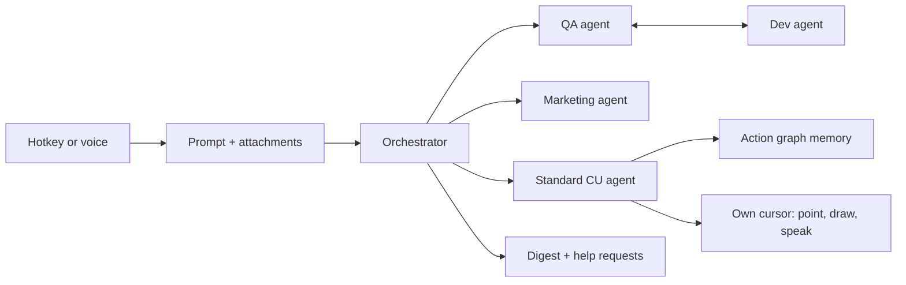

# ComputerAnything: technical design

ComputerAnything is an always-present macOS agent. You press a hotkey, speak or type one prompt with any attachments, and a multi-agent pipeline does the computer-use task. It has its own cursor: a blue triangle that flies to UI elements, draws shapes, highlights text and talks back.

Phase 1 is the core: computer use, the cursor and drawing layer, screen and audio understanding, speech in and speech out. The main score is OSWorld 2.1, where the best agent completes 44.3% of tasks. Talk2Agent scores speech understanding with 1,755 human-spoken OSWorld recordings.

## Stack

| Layer | Choice |
|---|---|
| Brain | Gemini 4 Argon via OpenRouter (`google/gemini-4-argon`) |
| Typed judgments | System One model (TypeSafe Jev) for done, captcha and destructive checks |
| Actions | vercel-labs/agent-desktop, AX-first with pixel fallback |
| Cursor overlay | Clicky-style transparent NSPanel per screen (MIT base) |
| Voice | ElevenLabs TTS and STT, fast/slow dual loop |

## Sections

1. [Architecture](01-architecture.md): activation surface, orchestrator, agent roles, QA and dev loop, help UI, digest.
2. [Computer use](02-computer-use.md): observe, the decide cascade, grounding, action-graph memory, the planner math, policy.
3. [Cursor and voice](03-cursor-voice.md): overlay, tag protocol, coordinate math, drawing, voice latency.
4. [Benchmarks](04-benchmarks.md): OSWorld 2.1, Talk2Agent, smoke tests, ablations, statistics.

The working spike lives in [`app/`](../app/README.md).
