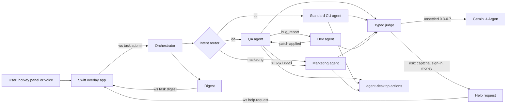
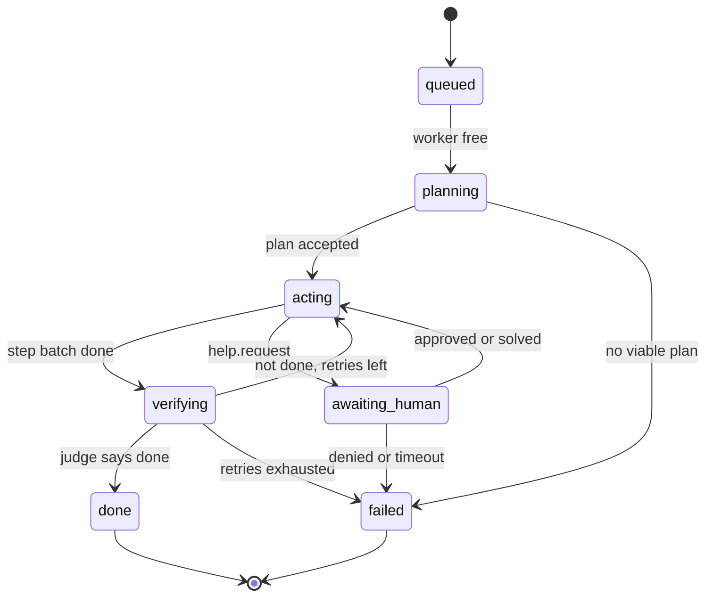

# ComputerAnything architecture

ComputerAnything is a macOS menu-bar agent. One prompt, with optional attachments or voice, becomes a job. An orchestrator routes that job to a pipeline of agents: QA, Dev, Marketing or a standard computer-use (CU) agent. Gemini 4 Argon plans. A cheap typed model makes the many small yes/no judgments, and plain code makes every decision. The user is asked for help on captchas, sign-ins and money. Every job ends with a digest.

The stack:

- Brain: `google/gemini-4-argon` through OpenRouter's OpenAI-compatible endpoint, `https://openrouter.ai/api/v1/chat/completions`.
- Actions: `vercel-labs/agent-desktop` (accessibility tree, clicks, typing, app launch).
- Cursor overlay: a fork of Clicky (MIT, `github.com/farzaa/clicky`).
- Voice out: ElevenLabs streaming TTS.



## 1. Activation surface

The Swift app runs as an `NSStatusItem` with no Dock icon. A global hotkey (default Option+Space, registered through `CGEventTap`) opens a floating `NSPanel` with `.nonactivatingPanel`, so focus stays in the user's app. The panel holds one text field, an attachment tray and a push-to-talk button.

Attachments are dropped or pasted into the tray. Accepted types are png, svg, jpg, mp4, mp3, pptx, docx and csv. The app copies each file into a job folder and sends its path, MIME type and SHA-256. It never sends raw bytes over the socket. The server extracts what the model needs: frames from mp4, a transcript from mp3, text and slide images from pptx and docx, and a header plus sample rows from csv.

Push-to-talk holds a key (default Fn). Audio streams to the server as 16 kHz PCM chunks, and the transcript fills the prompt field before submit. The overlay cursor shares one transparent full-screen `NSPanel` per display with the help prompts, so the agent can point at what it is asking about.

## 2. Orchestrator and job state

The orchestrator is a single process that owns a queue of jobs. The intent router makes one Gemini call with a JSON-schema response. It returns `{pipeline: "qa"|"cu"|"marketing", target_app?, repo?, success_criteria}`. Explicit tags in the prompt, such as `@Xcode` or `#repo-name`, override the router.

A job runs like a CI pipeline. Stages are ordered, each stage writes artifacts to the job folder, and a failed stage fails the job unless it has a retry left. The run state machine is the contract between server and UI. The UI renders only the states listed here.



## 3. Agent roles

QA agent. It reads the default editor from the `LSHandlerContentType` entry for `public.source-code`, then opens the repo by CLI (`code <path>`, `cursor <path>` or `zed <path>`). It reads the project's run script (`package.json` scripts, `Makefile`, `Procfile`) and starts the app on localhost. Then it explores the running app through computer use: it clicks each route, fills each form and compares against the success criteria. Every failure becomes an item in a typed bug report.

Dev agent. It takes the latest bug report and edits the repo. It runs the project's own tests and hands control back to QA. The loop ends when QA returns an empty report. Let `B_k` be the bug list after iteration `k`:

```
k = 0
B_0 = qa.run()
while len(B_k) > 0 and k < K_MAX:        # K_MAX = 5 by default
    dev.fix(B_k)
    k += 1
    B_k = qa.run()
    if fingerprints(B_k) == fingerprints(B_{k-1}):
        stall += 1
        if stall >= 2: break             # same bugs twice: stop early
    else:
        stall = 0
status = "done" if len(B_k) == 0 else "failed"
```

A bug fingerprint is `sha1(route + selector + expected + actual)`. A cap on Dev tokens per iteration guards cost as well.

Marketing agent. It runs after QA reports empty, or on its own prompt. It drives the app with Playwright and records with `recordVideo`. It asks Gemini for a shot list and a voiceover script, then renders the cut headlessly with Remotion (`npx remotion render`). ElevenLabs reads the narration.

Standard CU agent. It opens any app by bundle id through agent-desktop. It runs observe, plan and act steps until the typed judge says the task is done.

## 4. Typed decision layer

Most steps need a small judgment, not a plan. A System One model such as TypeSafe Jev answers a typed question with a calibrated probability. Its answer types are `Choice` (one of N labels) and `Noul` (a yes/no that may also be null when the input cannot answer it). Code reads the probability and decides. The model never acts.

Standard questions:

- `task_done: Noul` from the screenshot, the AX tree and the success criteria.
- `is_captcha: Noul` for the current screen.
- `is_sign_in: Noul` for the current screen.
- `action_risk: Choice[safe, destructive, financial]` for the next planned action.

The routing rule for a probability `p`:

```
if p >= 0.7:   accept the answer as true
elif p <= 0.3: accept the answer as false
else:          escalate to Gemini with the same inputs
```

Risk questions use a stricter rule. Any `destructive` or `financial` probability above 0.3 raises a help request. A wrong pause costs one click, while a wrong purchase costs money. Gemini handles planning and the 0.3 to 0.7 band only. That keeps most calls on the cheap model.

## 5. Ask for help

A help request moves the job to `awaiting_human` and shows a card beside the overlay cursor. A macOS notification carries the same buttons.

- Captcha: the agent points at the widget and waits for the user to solve it. It then re-asks `is_captcha` before it resumes.
- Sign-in: the card shows the app and account, with Approve and Deny. Approve lets the agent fill credentials from the Keychain item the user picks.
- Money: any financial action shows the amount, payee and source, with Confirm and Cancel. There is no remembered approval.

No answer means no. Each request has a timeout (default 120 s) after which it resolves to `deny`.

## 6. Digest

Every job ends with a digest, shown as a small card and saved as JSON in the job folder. It records what the agent did, how long it took, the step count, retries, cost, and links to screenshots and the recording.

## 7. Process and IPC layout

There are two processes. The Swift app (`ComputerAnything.app`) owns the UI, hotkeys, audio capture and the overlay. The agent server (Python, `uvicorn` with `websockets`) owns the orchestrator, the model clients and agent-desktop. They talk over `ws://127.0.0.1:8765/v1` with a per-launch token in the first frame. The server binds to loopback only.

Each frame is `{type, job_id, seq, ts, payload}`. Message types:

- Client to server: `hello`, `task.submit`, `task.cancel`, `audio.chunk`, `audio.end`, `help.response`.
- Server to client: `hello.ok`, `task.state` (the state machine above), `task.step`, `transcript.partial`, `cursor.point`, `cursor.draw`, `cursor.highlight`, `tts.chunk`, `help.request`, `task.digest`, `error`.

## Schemas

Task request (`task.submit` payload):

```json
{
  "$schema": "https://json-schema.org/draft/2020-12/schema",
  "title": "TaskRequest",
  "type": "object",
  "required": ["prompt"],
  "properties": {
    "prompt": {"type": "string"},
    "source": {"enum": ["text", "voice"]},
    "pipeline_hint": {"enum": ["qa", "cu", "marketing", null]},
    "target_app": {"type": "string", "description": "bundle id"},
    "repo_path": {"type": "string"},
    "attachments": {
      "type": "array",
      "items": {
        "type": "object",
        "required": ["path", "mime", "sha256"],
        "properties": {
          "path": {"type": "string"},
          "mime": {"enum": ["image/png", "image/svg+xml", "image/jpeg", "video/mp4", "audio/mpeg",
            "application/vnd.openxmlformats-officedocument.presentationml.presentation",
            "application/vnd.openxmlformats-officedocument.wordprocessingml.document", "text/csv"]},
          "sha256": {"type": "string"}
        }
      }
    },
    "budget_usd": {"type": "number", "default": 2.0}
  }
}
```

Bug report (QA to Dev):

```json
{
  "title": "BugReport",
  "type": "object",
  "required": ["job_id", "iteration", "app_url", "bugs"],
  "properties": {
    "job_id": {"type": "string"},
    "iteration": {"type": "integer", "minimum": 0},
    "app_url": {"type": "string"},
    "bugs": {
      "type": "array",
      "items": {
        "type": "object",
        "required": ["fingerprint", "severity", "route", "steps", "expected", "actual"],
        "properties": {
          "fingerprint": {"type": "string"},
          "severity": {"enum": ["blocker", "major", "minor"]},
          "route": {"type": "string"},
          "selector": {"type": "string"},
          "steps": {"type": "array", "items": {"type": "string"}},
          "expected": {"type": "string"},
          "actual": {"type": "string"},
          "console_errors": {"type": "array", "items": {"type": "string"}},
          "screenshot": {"type": "string"},
          "suspect_files": {"type": "array", "items": {"type": "string"}}
        }
      }
    }
  }
}
```

Help request (`help.request` payload; the reply is `help.response` with `{request_id, decision: "approve"|"deny"|"solved"}`):

```json
{
  "title": "HelpRequest",
  "type": "object",
  "required": ["request_id", "kind", "message", "timeout_s"],
  "properties": {
    "request_id": {"type": "string"},
    "kind": {"enum": ["captcha", "sign_in", "financial", "destructive", "clarify"]},
    "message": {"type": "string"},
    "app": {"type": "string"},
    "screen_rect": {"type": "array", "items": {"type": "number"}, "minItems": 4, "maxItems": 4},
    "amount": {"type": "object", "properties": {"value": {"type": "number"}, "currency": {"type": "string"}, "payee": {"type": "string"}}},
    "p_judge": {"type": "number", "minimum": 0, "maximum": 1},
    "timeout_s": {"type": "integer", "default": 120},
    "default_on_timeout": {"const": "deny"}
  }
}
```

Digest (`task.digest` payload):

```json
{
  "title": "Digest",
  "type": "object",
  "required": ["job_id", "summary", "status", "duration_s", "steps", "retries", "cost_usd"],
  "properties": {
    "job_id": {"type": "string"},
    "summary": {"type": "string"},
    "status": {"enum": ["done", "failed"]},
    "pipeline": {"enum": ["qa", "cu", "marketing"]},
    "duration_s": {"type": "number"},
    "steps": {"type": "integer"},
    "retries": {"type": "integer"},
    "qa_iterations": {"type": "integer"},
    "help_requests": {"type": "integer"},
    "cost_usd": {"type": "number"},
    "model_calls": {"type": "object", "properties": {"gemini": {"type": "integer"}, "typed_judge": {"type": "integer"}}},
    "screenshots": {"type": "array", "items": {"type": "string"}},
    "recording": {"type": "string"},
    "artifacts": {"type": "array", "items": {"type": "string"}}
  }
}
```
