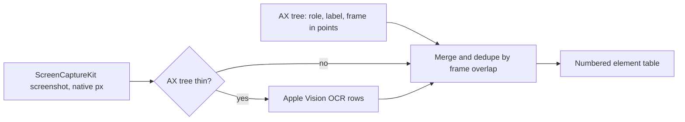
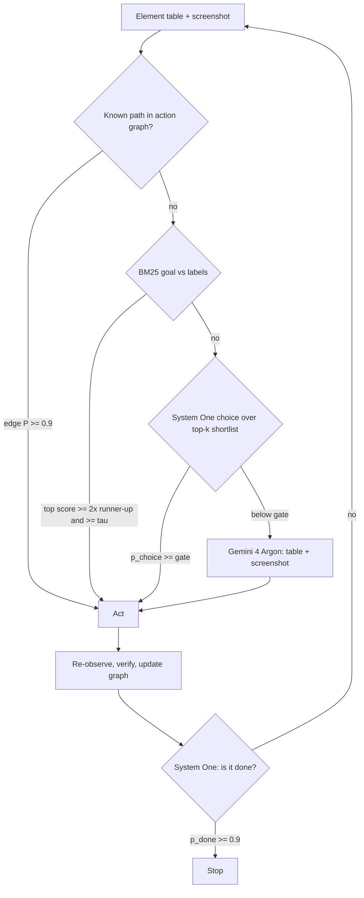
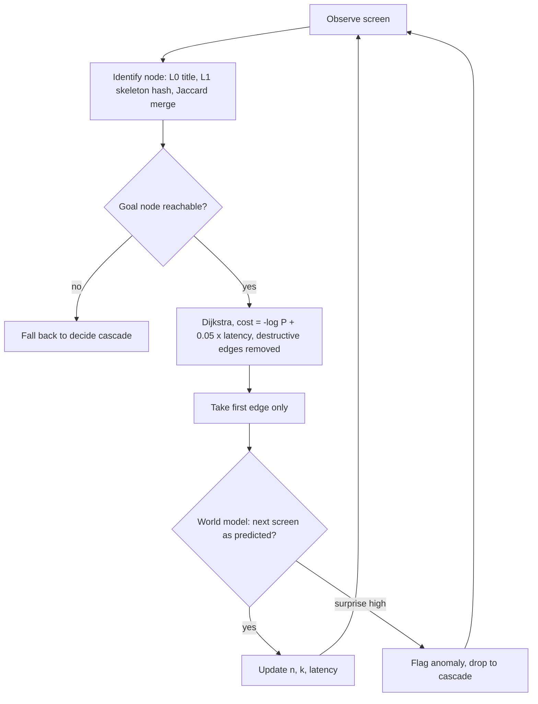

# 02. Computer use: how ComputerAnything sees, decides and acts

ComputerAnything reads the screen as a typed element table and tries the cheapest decision first. It calls Gemini 4 Argon (`google/gemini-4-argon` via OpenRouter) only when a cheaper layer is unsure. Every step feeds a per-app action graph, so a task that needed the model on Monday replays from memory on Friday. The action layer is vercel-labs/agent-desktop, which wraps the macOS accessibility API and synthetic input.

## 1. Observe

Each step starts with one observation. It merges three sources, in order of trust:

1. The accessibility (AX) tree of the frontmost app. Each element gives a role, a label (title, description or value) and a frame in display points.
2. A ScreenCaptureKit screenshot of the active display, captured at native pixel resolution.
3. Apple Vision OCR on the screenshot. This runs only when the AX tree is thin, as in canvas apps, games and some Electron windows.



The merged elements become a numbered table. Each row carries an index, a role, a label and a coarse position bucket (top, mid, bottom):

```
[1] Window "Untitled 3 - Notes" (top)
[2] TextArea "" (mid)
[3] Button "Save" (mid)
[4] MenuItem "Share..." (top)
[5] OCRText "Last edited 10:42" (bottom)
```

The table is the shared language of every layer below. A replayed path, a lexical match and the model all answer with a row index. That keeps the action space discrete and auditable. OCR rows carry their own role so the planner knows they have no AX handle.

## 2. Decide: the cascade

The decider runs four layers, cheapest first, and stops at the first one that clears its gate.



Layer (a) is replay. If the current screen matches a known node and the graph holds a reliable edge toward the goal, the agent takes it with no model call.

Layer (b) is lexical. It scores each label against the goal with BM25:

$$
\mathrm{BM25}(g, e) = \sum_{t \in g} \mathrm{IDF}(t)\,\frac{f(t,e)\,(k_1+1)}{f(t,e) + k_1\left(1 - b + b\,\frac{|e|}{\overline{|e|}}\right)}
$$

This rewards labels that contain rare goal words, without letting long labels win by length alone. Here $g$ is the goal text, $e$ an element label, $f(t,e)$ the count of term $t$ in $e$, $|e|$ the label length in tokens and $\overline{|e|}$ the mean label length on this screen. We use $k_1 = 1.2$ and $b = 0.75$. With IDF("save") = 2.1, one occurrence and a label of average length, the term adds $2.1 \times 2.2 / 2.2 = 2.1$.

The lexical layer fires only on a strong match. The top score must reach $\tau = 2.0$ and be at least twice the runner-up. "Save" on a screen with one Save button passes. Two "Save" buttons fail and fall through.

Layer (c) is a typed System One model. It takes the goal and a shortlist of the top $k = 8$ rows. It returns a calibrated choice distribution and a separate done probability. It acts when:

$$
p_{\max} = \max_{i \le k} p(i \mid g, \text{table}) \ge \gamma
$$

The decision passes only when one candidate holds most of the probability mass. $p(i \mid \cdot)$ is the model's probability that row $i$ is the right target, and $\gamma = 0.75$ is the gate. A spread of 0.81, 0.11 and 0.08 acts on row one; 0.48 and 0.44 escalates.

Layer (d) sends the full table plus the screenshot to Gemini 4 Argon. It returns one action as JSON: a row index, a verb (press, type, scroll, key) and an argument.

The cascade cuts cost because most steps are routine. Expected cost per step is a hit-rate-weighted sum:

$$
\mathbb{E}[C] = h_a c_a + (1-h_a)\big[h_b c_b + (1-h_b)\big(h_c c_c + (1-h_c)\,c_d\big)\big]
$$

Each layer pays only for the steps the cheaper layers could not settle. $h_x$ is the hit rate of layer $x$ and $c_x$ its cost. Take $h_a = 0.4$, $h_b = 0.3$, $h_c = 0.6$ and latencies of 5, 2, 60 and 2,500 ms. That gives $\mathbb{E}[C] \approx 2 + 0.6[0.6 + 0.7(36 + 1000)] \approx 438$ ms, against 2,500 ms for a model-only agent.

## 3. Grounding

The agent acts through the AX handle first. Pressing `AXPress` on row 3 does not depend on pixels, window position or display scale. It also survives a window that moves between observe and act.

When a row has no AX handle (OCR rows, custom canvases), the agent falls back to a pixel click. It draws set-of-marks labels on the screenshot so Gemini can name a mark rather than guess coordinates. The mark's centre then goes through a coordinate transform. For a point $(u, v)$ in screenshot pixels on display $d$:

$$
x = o_x^{(d)} + \frac{u}{s^{(d)}}, \qquad y_{\text{CG}} = o_y^{(d)} + \frac{v}{s^{(d)}}
$$

This converts capture pixels into global display points, which is what synthetic mouse events take. $s^{(d)}$ is the backing scale factor (2.0 on Retina), and $(o_x^{(d)}, o_y^{(d)})$ is the display's origin in the global top-left space. A secondary display to the left has a negative $o_x$. A mark at $(1800, 900)$ px on a Retina display at origin $(-1512, 0)$ lands at $(-612, 450)$ points.

AppKit reports window frames with the origin at the bottom-left of the main display. Before AX frames and click points can be compared, the y axis flips:

$$
y_{\text{CG}} = H_{\text{main}} - y_{\text{AppKit}} - h
$$

This turns a bottom-left frame into a top-left one. $H_{\text{main}}$ is the main display height in points and $h$ is the element height. A 30 pt button at AppKit $y = 800$ on a 982 pt display has its top at $982 - 800 - 30 = 152$.

## 4. Action graph memory

The graph is why the agent gets better with use. Each app has a state machine. Nodes are screens and edges are actions.

Node identity has two levels. L0 is the pair (app bundle id, screen title). L1 is a hash of the structural skeleton: the sequence of roles and stable labels, with numbers, dates and times removed. "Inbox (12)" and "Inbox (13)" therefore hash the same. Two candidate nodes merge when their label sets overlap enough:

$$
J(A, B) = \frac{|A \cap B|}{|A \cup B|} \ge 0.8
$$

Two screens count as one state when most of their labels match. $A$ and $B$ are the label sets of the two screens. With 34 shared labels out of 40 distinct, $J = 0.85$ and they merge.

Each edge (node, action) keeps attempts $n$, successes $k$, latency p50 and p95, a next-node distribution and a destructive flag. Success probability is the posterior mean under a uniform Beta(1,1) prior:

$$
P = \frac{1 + k}{2 + n}
$$

This shrinks early estimates toward one half until evidence piles up. One success in one try gives $P = 2/3$, not 1. Nineteen in twenty gives $P = 20/22 \approx 0.91$.

An edge is destructive when its label or typed text matches `send|pay|buy|delete|post|transfer|submit|purchase|confirm|remove`. The planner never routes through a destructive edge. It can only end a path on one, after approval (section 5).

The planner runs Dijkstra from the current node to any node that satisfies the goal. Edge cost is:

$$
c(e) = -\log P(e) + \lambda\, t_{50}(e), \qquad \lambda = 0.05
$$

Summing $-\log P$ along a path maximises the path's joint success probability, and the latency term breaks ties toward faster routes. $t_{50}$ is median latency in seconds. An edge with $P = 0.95$ and $t_{50} = 1.2$ s costs $0.051 + 0.06 = 0.111$. An edge with $P = 0.7$ and 0.3 s costs $0.357 + 0.015 = 0.372$, so the reliable one wins.



The agent replans after every step. It takes only the first edge, re-observes and re-identifies the node. A stale plan never runs blind through a screen that changed.

Macro induction turns repeated wins into skills. When the same edge sequence succeeds three or more times from the same start node, it becomes a named macro for that app. Examples are "new note with title" in Notes and "export as PDF" in Preview. A macro is one edge in the planner, with its own $n$, $k$ and latency.

The predictive world model maps (screen, action) to a distribution over next screen, a latency and $P$. It is the graph's next-node table plus a learned fallback for unseen edges. Anomalies are scored by surprise:

$$
\text{surprise} = -\log q(s' \mid s, a)
$$

A screen the model expected is cheap; a screen it never predicted is expensive. $q$ is the predicted probability of the observed next screen $s'$. With $q = 0.02$, surprise is 3.9 nats, above the 3.0 threshold, so the step is flagged.

Why chase per-step reliability? Task success is a product:

$$
P_{\text{task}} = \prod_{i=1}^{N} p_i
$$

One weak step drags the whole task down. $p_i$ is the success probability of step $i$ and $N$ the step count. At $p = 0.98$ over 20 steps, $0.98^{20} \approx 0.67$; at 0.995 it is 0.90. Short verified segments help because each check catches a failure before it compounds. Retrying a failed segment of 5 steps costs far less than restarting 20.

## 5. Safety and policy

The policy engine runs before every action and cannot be bypassed by the decider.

- Per-app allow and deny. Banking, password managers and health apps are denied by default. The user allows an app by bundle id. The agent never reads or types in a denied app.
- Approval on destructive edges. Any action flagged destructive blocks until the user approves it in the overlay. The prompt shows the action, the target label and the typed text. A timeout counts as no.
- Least privilege at permission popups. When macOS asks for camera, location, contacts or similar, the agent picks the narrowest option ("Allow once", "Only while using"). It never chooses "Always allow" on its own.
- Audit log. Every action appends one JSON line to an append-only log: time, app, node id, action, policy verdict and approver. Lines are never rewritten.

## 6. Storage

Each run writes a trace as JSONL, one line per step, plus an mp4 screen recording of the same run. A trace line looks like this:

```json
{"step": 7, "app": "com.apple.Notes", "node": "notes:editor:9f2c",
 "screen_table": ["[1] Window \"Untitled 3 - Notes\" (top)", "[3] Button \"Save\" (mid)"],
 "action": {"layer": "bm25", "verb": "press", "row": 3, "via": "ax"},
 "observe_ms": 41, "decide_ms": 2, "act_ms": 18,
 "outcome": {"ok": true, "next_node": "notes:list:11ab", "surprise": 0.4}}
```

The `layer` field records which cascade layer decided. That gives a per-layer hit rate for free, which feeds $h_a$ to $h_d$ above. The graph rebuilds from traces alone, so the recording and the JSONL are the ground truth for debugging a run.
