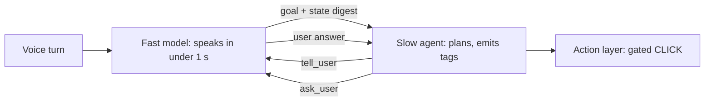
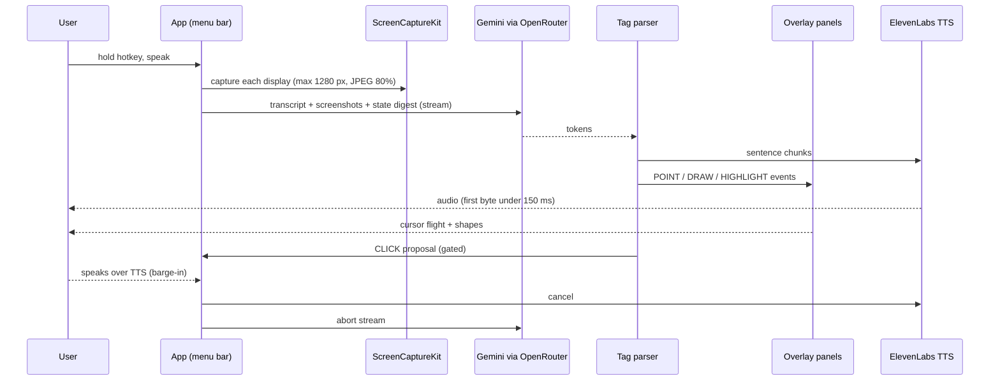

# Cursor overlay and voice loop

ComputerAnything draws on one click-through panel per screen, reads `[TAG:...]` markers out of the model's token stream, and speaks the text between them. The cursor starts moving the moment a tag closes, so it usually arrives before the sentence that mentions it. The design follows Clicky (MIT) and adds drawing, highlights, gated clicks and a fast/slow model split from TalkAct.

## 1. Overlay window

Each `NSScreen` gets one borderless `NSPanel`. It must never take focus, never block input, and never show up in our own screenshots.

| Property | Value | Why |
|---|---|---|
| `level` | `.screenSaver` (or `CGShieldingWindowLevel()`) | Sits above menus and the Dock |
| `ignoresMouseEvents` | `true` | The real cursor keeps working underneath |
| `collectionBehavior` | `.canJoinAllSpaces`, `.fullScreenAuxiliary`, `.stationary`, `.ignoresCycle` | Visible on every Space and over full-screen apps |
| `styleMask` | `.borderless`, `.nonactivatingPanel` | No activation, no title bar |
| `backgroundColor` | `.clear`, `isOpaque = false` | Transparent canvas |

```swift
func makeOverlay(for screen: NSScreen) -> NSPanel {
    let p = NSPanel(contentRect: screen.frame,
                    styleMask: [.borderless, .nonactivatingPanel],
                    backing: .buffered, defer: false, screen: screen)
    p.level = .screenSaver
    p.isOpaque = false
    p.backgroundColor = .clear
    p.hasShadow = false
    p.ignoresMouseEvents = true
    p.collectionBehavior = [.canJoinAllSpaces, .fullScreenAuxiliary,
                            .stationary, .ignoresCycle]
    let host = NSView(frame: NSRect(origin: .zero, size: screen.frame.size))
    host.wantsLayer = true
    p.contentView = host
    p.orderFrontRegardless()
    return p
}
```

Rebuild the panels on `NSApplication.didChangeScreenParametersNotification`. For capture, build the `SCContentFilter` with `excludingWindows:` set to our panels' `SCWindow` matches, found by `windowID`. The model then never sees its own arrows and circles, and never tries to click them.

## 2. Tag protocol

The model emits plain speech with inline tags. Coordinates are screenshot pixels, top-left origin, in the image the model saw. Every spatial tag takes an optional `:screenN` suffix (1-based, default 1).

```
tag    := '[' ( point | draw | hl | click | say ) ']'
point  := 'POINT:' int ',' int ':' label [ ':screen' int ]
draw   := 'DRAW:' ( 'circle' | 'rect' | 'arrow' ) ':' int ',' int ',' int ',' int [ ':' color ]
hl     := 'HIGHLIGHT:' int ',' int ',' int ',' int [ ':screen' int ]
click  := 'CLICK:' int ',' int [ ':screen' int ]
say    := 'SAY:' text
```

For `circle` and `rect`, the four numbers are x, y, width, height. For `arrow`, they are the tail (x, y) and the vector (dx, dy). Regexes, one per tag:

```
POINT      \[POINT:(\d+),(\d+):([^:\]]{0,60})(?::screen(\d+))?\]
DRAW       \[DRAW:(circle|rect|arrow):(-?\d+),(-?\d+),(-?\d+),(-?\d+)(?::(red|green|blue|yellow|#[0-9a-fA-F]{6}))?(?::screen(\d+))?\]
HIGHLIGHT  \[HIGHLIGHT:(\d+),(\d+),(\d+),(\d+)(?::screen(\d+))?\]
CLICK      \[CLICK:(\d+),(\d+)(?::screen(\d+))?\]
SAY        \[SAY:([^\]]{1,400})\]
```

`SAY` lets the model speak text that should not appear in the transcript, such as a short status line during a long action.

`CLICK` is the only tag with side effects. The parser never executes it. It produces a `ProposedAction` for the action layer, which checks an allowlist of apps, shows a confirm ring at the target, and waits for a spoken "yes" or a key press. Unknown or malformed tags are dropped silently and logged.

### Streaming parse

Tokens arrive in arbitrary fragments, so the parser is a small state machine over a string buffer.

1. In `TEXT` state, append characters to the speech buffer. On `[`, switch to `TAG` and start a tag buffer.
2. In `TAG` state, append until `]`. Match the buffer against the five regexes and emit one event on success.
3. If the tag buffer passes 420 characters, or a second `[` appears, the tag was not a tag. Flush it back into speech and return to `TEXT`.
4. In `TEXT`, cut the speech buffer at sentence ends (`. ! ? ` plus a space) and send each sentence to TTS at once.

Because tags and sentences leave the parser in stream order, "Click the blue button [POINT:...]" sends the sentence to TTS and the cursor to the overlay in the same tick. Flight takes 400 to 700 ms, which covers TTS startup.

## 3. Coordinate math

Let a screenshot be W_s by H_s pixels, taken of a display with frame F = (o_x, o_y, W_p, H_p) in AppKit global points (bottom-left origin). A tag point (x_s, y_s) maps to:

- x_pt = x_s · (W_p / W_s)
- y_top = y_s · (H_p / H_s)
- y_local = H_p − y_top (flip for AppKit)
- global = (o_x + x_pt, o_y + y_local)

The overlay panel for that display has its origin at F, so its local point is (x_pt, y_local). Backing scale does not appear in the formula. Points already absorb it, and only the ratio of screenshot size to point size matters.

Worked example with two monitors, tops aligned:

| | Monitor 1 (laptop) | Monitor 2 (external) |
|---|---|---|
| Pixels | 2560 x 1600, scale 2 | 3840 x 2160, scale 2 |
| Points (W_p x H_p) | 1280 x 800 | 1920 x 1080 |
| Frame origin (AppKit) | (0, 0) | (1280, -280) |
| Screenshot sent | 1280 x 800 | 1280 x 720 |
| Points per screenshot px | 1280/1280 = 1.0 | 1920/1280 = 1.5 |

Tag `[POINT:320,100:Save:screen1]`: x_pt = 320, y_top = 100, y_local = 800 − 100 = 700, global = (320, 700).

Tag `[POINT:640,360:Share:screen2]`: x_pt = 640 · 1.5 = 960, y_top = 360 · 1.5 = 540, y_local = 1080 − 540 = 540, global = (1280 + 960, −280 + 540) = (2240, 260).

For a real click, `CGEvent` wants top-left Quartz coordinates relative to the main display. Both tops sit at y = 800 in AppKit, so the Quartz y is simply y_top = 540, and the click lands at (2240, 540). If the tops were not aligned, convert with y_quartz = H_main − (o_y + y_local).

## 4. Drawing and highlights

Each shape is a `CAShapeLayer` added to the overlay's host layer. A `CGPath` holds the geometry: `ellipseIn:` for circles, rounded rect for boxes, and a line plus two head strokes for arrows. Set `fillColor = nil`, `lineWidth = 4`, `lineCap = .round`, and a soft shadow so the stroke reads on any background.

Animate `strokeEnd` from 0 to 1 over 350 ms with `CABasicAnimation` and an ease-out curve. Circles feel hand-drawn if the path starts at the top and runs clockwise. A fade timer (default 6 s) animates `opacity` to 0 over 300 ms, then removes the layer. Starting a new response clears all layers from the last one.

`HIGHLIGHT` fills a translucent yellow rect (alpha 0.35, `multiply` compositing filter) with a 4 pt corner radius. To find exact text bounds:

1. Query the focused app through Accessibility. Find the `AXStaticText` or `AXTextArea` element under the target point.
2. Locate the phrase in `AXValue`, build a `CFRange`, and call `AXUIElementCopyParameterizedAttributeValue` with `kAXBoundsForRangeParameterizedAttribute`. The result is in global top-left screen coordinates.
3. If the element does not support it (Electron, canvas, PDF), run Vision `VNRecognizeTextRequest` on the cropped screenshot and take the word boxes that match the phrase. Merge boxes on the same line.

Prefer AX because it survives scrolling and costs no inference. OCR is the fallback and carries a few pixels of error.

## 5. Voice loop

Two models share the turn. This is the TalkAct pattern. A fast conversational model owns the voice and answers in under a second. A slow computer-use agent plans and acts in the background. The fast model gets a state digest with every action: current app, last tags, pending clicks, errors. It can speak for the agent (`tell_user`) and put the agent's question to the user (`ask_user`), then pass the answer back.

Here the fast model is Gemini via OpenRouter with a short prompt and a low thinking budget. The slow agent is Gemini 4 Argon (`google/gemini-4-argon`) with the full screenshot set. Both emit the tag grammar above.



Latency budget, push-to-talk release to first sound. These are targets to measure, not measured values.

| Stage | Budget (ms) | Notes |
|---|---|---|
| VAD end-of-speech | 0 to 150 | Free with push-to-talk release |
| ASR final after partials | 100 | Partials stream during speech, so only the tail remains |
| Screenshot, resize, JPEG | 80 | Parallel with ASR tail |
| First LLM token | 350 | Fast model, screenshots cached from hotkey press |
| TTS first audio byte | 150 | ElevenLabs flash over WebSocket, first sentence only |
| Total | about 800 | Cursor leaves before audio starts |

Capture the screenshot on hotkey press, not on release, so the image is ready when ASR finishes. Send the first TTS chunk after the first complete clause, not the first sentence, if the clause is at least four words.

ASR sits behind a protocol: `start()`, `partials: AsyncStream<String>`, `finish() -> String`. ElevenLabs Scribe realtime is the default, and Gemini audio input is the second implementation.

Barge-in: while TTS plays, the mic stays hot with acoustic echo cancellation on (`AVAudioEngine` voice processing). Energy above threshold for 120 ms stops the player, cancels the WebSocket, clears overlay shapes, and aborts the LLM stream. The partial transcript starts the next turn.



## 6. Audio-visual context

ScreenCaptureKit also captures system audio. Set `SCStreamConfiguration.capturesAudio = true` and `excludesCurrentProcessAudio = true`, so our own TTS never feeds back. Buffers arrive as `CMSampleBuffer` audio at 48 kHz.

The user opts in per session from the menu bar, with a visible indicator while capture runs. The app keeps a 30-second ring buffer in memory, never on disk. When a question refers to the video playing or to what someone just said, the app sends the last N seconds as an audio part to Gemini. It can also run them through streaming ASR for a text transcript. Meeting audio then lets the agent point at the slide being discussed. Nothing leaves the machine unless the user asked a question that needs it.
