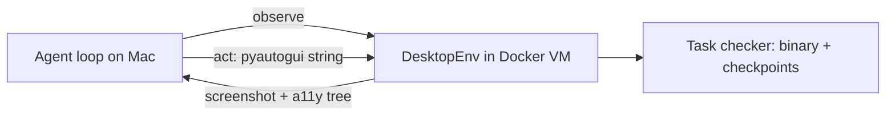
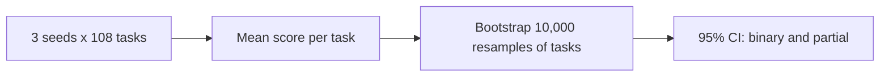

# Benchmarks

ComputerAnything is scored on OSWorld 2.1 (main), Talk2Agent (speech) and a 20-task OSWorld-Verified smoke test. OSWorld-Verified no longer separates systems, so it only proves the plumbing works. Facts below were checked on 2026-11-14.

## 1. Why OSWorld-Verified stopped being the test

OSWorld-Verified has 369 tasks and a human baseline of 72.36%. Several systems now sit above that line. Intelligence-Indeed Agent leads the official board at 90.19%, then Claude Fable 5 at 85.96% and Claude Opus 5 at 83.39% (presenc.ai OSWorld leaderboard). Self-reported numbers sit close by: Qwen3.8-Max 86.1%, Kimi K3 84.8%, Gemini 3.6 Flash 83% (aicost.tools).

With a 369-task suite, a 1-point gap is 3.7 tasks. Run-to-run noise on a stochastic agent is larger than that. A top-six spread of about 7 points cannot rank products. It can still catch a broken harness, which is why we keep a 20-task subset.

## 2. OSWorld 2.1 on our side

OSWorld 2.1 (XLANG Lab, arXiv 2606.29537, released 2026-09-16) has 108 long-horizon workflows across 31 self-hosted websites and desktop apps. Median human time is 1.6 hours per task, and agents average about 318 tool calls. Scoring is binary completion within 500 steps, plus a partial score over about 27.25 checkpoints per task.

Reported results show how much headroom exists. Claude Opus 5 at max effort scores 44.33% binary and 77.67% partial on v2.1, but only 18.81% binary at low effort. At release, Opus 4.8 scored 20.6% binary at roughly $72 per task, and GPT-5.5 scored 13.0% at roughly $25 per task.

### Harness and setup

The harness is `github.com/xlang-ai/OSWorld-V2`, pinned to tag `osworld-v2.1`. Do not mix releases or track `main`.

```bash
git clone --branch osworld-v2.1 https://github.com/xlang-ai/OSWorld-V2
cd OSWorld-V2
uv sync --frozen            # Python >= 3.12
uv run scripts/tools/download_osworld_v2_tasks.py --benchmark-release osworld-v2.1
uv run scripts/tools/download_osworld_v2_assets.py \
  --benchmark-release osworld-v2.1 --target-dir cache/osworld_v2_assets_v2.1
export OSWORLD_FILE_BASE_URL="$(pwd)/cache/osworld_v2_assets_v2.1"
export OSWORLD_BENCHMARK_RELEASE="osworld-v2.1"
export WEBSITE_HOST_SUFFIX="<our-v2.1-host-suffix>"
```

The task websites (`Task-Web/OSWorld-web@osworld-v2.1`) must be self-hosted. The assets repo is gated on Hugging Face, so request access first.

### VM provider

Only Docker and AWS have shipped images for 2.1. We use Docker with KVM on a Linux host: image `xlangai/v2-image@osworld-v2.1`, VM login `user` / `osworld-public-evaluation`. The AWS AMI is `ami-01017272139e01feb` in us-east-1 at 1920x1080, and it needs ports 3000 and 8000 open. macOS hosts have no KVM, so the benchmark VM runs on a remote Linux box. Our agent runs on the Mac and talks to the VM over the harness API.



### Agent adapter

The adapter implements two calls. The harness defaults are `--action_space pyautogui`, `--observation_type screenshot_a11y_tree` and 1920x1080, and we set `--max_steps 500`.

```python
class Adapter:
    def observe(self) -> Obs:        # screenshot PNG + a11y tree
        ...
    def act(self, action: Action) -> str:  # returns a pyautogui snippet
        ...
```

Our action schema maps one-to-one onto pyautogui calls.

| Our action | pyautogui output |
|---|---|
| `move(x, y)` | `pyautogui.moveTo(x, y)` |
| `click(x, y, button)` | `pyautogui.click(x, y, button=...)` |
| `double_click(x, y)` | `pyautogui.doubleClick(x, y)` |
| `drag(x1, y1, x2, y2)` | `moveTo` then `dragTo(x2, y2, duration=0.4)` |
| `type(text)` | `pyautogui.write(text)` |
| `key(combo)` | `pyautogui.hotkey(*combo)` |
| `scroll(dy)` | `pyautogui.scroll(dy)` |
| `wait(s)` | `time.sleep(s)` |

Our on-screen cursor overlay and speech are disabled in the benchmark VM. They are scored in the voice track instead.

### Cost model

Expected cost of one full run:

```
C_run = N_tasks x S x (T_in x P_in + T_out x P_out)
```

`N_tasks` = 108. `S` = steps per task (about 318 observed). `T_in` = input tokens per step after truncation and caching. `T_out` = output tokens per step. `P_in`, `P_out` = price per token for `google/gemini-4-argon` on OpenRouter.

Worked estimate. Assume `T_in` = 12,000 (one screenshot, a trimmed a11y tree, three prior turns) and `T_out` = 150. Per task that is 3.82M input and 47.7k output tokens. The prices below are placeholders only.

| Quantity | Value |
|---|---|
| P_in | TO-FILL from OpenRouter pricing (placeholder $1.00 per M) |
| P_out | TO-FILL from OpenRouter pricing (placeholder $5.00 per M) |
| Cost per task | 3.82 x 1.00 + 0.048 x 5.00 = about $4.06 |
| One run, 108 tasks | about $438 |
| Three seeds | about $1,314 |

Cached input usually bills well below the base rate, so this is an upper bound until we measure the cache hit rate. For scale, the published Opus 4.8 figure of $72 per task would be $7,776 per run.

## 3. Talk2Agent protocol

Talk2Agent (arXiv 2609.38867) turns OSWorld and WildClawBench into human-spoken tasks. OSWorld contributes 351 tasks with 5 recordings each, 1,755 clips and 6.98 hours. WildClawBench contributes 60 tasks with 10 recordings each, 600 clips and 24.84 hours. Prompts were rewritten into speakable scripts, so paths and filenames are spoken explicitly. The headline result: its execution-free, task-conditioned retention metric correlates with completion 0.246 Pearson higher than WER or CER. On WildClawBench, execution fell from 40.75% on text to 24.20% through Parakeet ASR.

Data download URL: UNCONFIRMED. The paper page is `arxiv.org/abs/2609.38867`, and I found no dataset link in three searches. Check the paper's project links before the run, and fall back to contacting the authors.

Our protocol, per recording:

1. Feed the WAV through our STT path. Two arms: ElevenLabs Scribe, and Gemini native audio (audio goes to the model, no separate transcript).
2. Compute retention with the paper's projection of the task grader onto prompt-addressable intentions. This costs no VM time, so run it on all 1,755 OSWorld clips.
3. Execute a sample. Talk2Agent covers the original 351 OSWorld tasks, not the 108 OSWorld 2.1 workflows. We run execution on a 60-task subset, 5 recordings each, and report completion next to the text-prompt baseline.
4. Report retention, execution and WER together, to check the paper's claim that retention predicts completion better than WER.

## 4. OSWorld-Verified smoke subset

Twenty tasks, drawn once with a fixed seed (`seed=14`), stratified by app family: 4 each from Chrome, LibreOffice (Writer, Calc, Impress combined), the file manager and terminal, VS Code or GIMP, and multi-app. The list is committed to the repo and never changes. Pass bar: at least 14 of 20 on a single seed, and zero harness crashes. The pass bar checks plumbing, not quality. The subset takes about 20 tasks x 15 steps, a few dollars.

## 5. Ablation matrix

Each row changes one factor and keeps the rest fixed. Voice rows use the Talk2Agent audio, text rows use the original prompt.

| Factor | Arm A | Arm B | Metric it moves |
|---|---|---|---|
| Input modality | Voice (Scribe or native audio) | Typed text | Retention, then binary completion |
| Action-graph memory | On | Off | Steps to completion, partial score |
| Typed decision model | On | Off | Wrong-action rate, binary completion |
| Grounding | AX-first, pixel fallback | Pixel-only | Click-miss rate, steps, cost |

Expected direction: memory should cut repeated exploration on 300-step tasks. The decision model should reduce irreversible mistakes. AX-first grounding should lower cost, since a11y text is cheaper than screenshots. Voice should lose a few points of completion versus text, and the gap should shrink with Scribe plus ontology repair.

## 6. Statistics



We report binary completion and partial score, each with a 95% bootstrap CI. Resample the 108 tasks with replacement 10,000 times and take the 2.5 and 97.5 percentiles. Each task's score is the mean over 3 seeds, so seeds do not count as extra tasks. We also report pass@1 per seed.

Minimum detectable effect for two arms, using n = 108, p of about 0.3, 80% power and alpha of 0.05:

```
MDE = 2.8 x sqrt(2 p (1 - p) / n)
    = 2.8 x sqrt(2 x 0.3 x 0.7 / 108)
    = 2.8 x sqrt(0.003889)
    = 2.8 x 0.0624 = 0.175
```

Two independent arms must differ by about 17.5 points to be detected. That is too coarse for most ablations. Two fixes help. Run both arms on the same tasks and use a paired bootstrap or McNemar test, which has smaller variance. And lean on the partial score: about 27 checkpoints per task give far less noise than a 0/1 outcome. Report any difference below 17.5 points on binary as exploratory.

## 7. SOTA comparison

| Benchmark | Size | Best known | Notes |
|---|---|---|---|
| OSWorld-Verified | 369 tasks | 90.19% (Intelligence-Indeed Agent) | Saturated, human 72.36% |
| OSWorld 2.1 | 108 workflows | 44.33% binary, 77.67% partial (Claude Opus 5, max effort) | Our main score |
| OSWorld-Pro (arXiv 2609.24890) | process-based | 75.7% (Claude Opus 5) | Scores the path, not only the result |
| WeaveBench (arXiv 2606.09426) | GUI plus CLI | 41.2% | Hybrid tasks |
| MacArena (arXiv 2606.06560) | 421 macOS tasks | 31.83% at 15 steps | Apple Virtualization, closest to our platform |
| FrontierCUA (Collinear, 2026-11-06) | 40 private workflows | 25% (GPT-6.1 Sol) | Enterprise, private |
| Browser Use Bench v2.1 | 180 live tasks | 81.3 (GPT-6.1 Sol) | Browser only |
| Browserbase Benchmark v2 | 23 models x 9 harnesses | opus-5 74% at $1.50 per task | Harness matters as much as model |
| Odysseys2 | long tasks | 47 of 100 perfect (GPT-6 Astra) | |
| knows (arXiv 2609.30604) | | under 3% full success | |
| Talk2Agent | 1,755 OSWorld clips | no leaderboard | Retention metric |

Two readings matter for planning. Effort and harness shift scores as much as the model does: Opus 5 moves from 18.81% to 44.33% with effort, and Browserbase shows a 3-point score gap at roughly 7x cost. So we log effort, step budget and cost per task with every score, and compare against others only at matched settings. MacArena is worth adding later, because it is macOS-native and our product is too.

## Open items

- Fill `P_in` and `P_out` from OpenRouter for `google/gemini-4-argon`.
- Find the Talk2Agent data URL (UNCONFIRMED).
- Request gated access to `xlangai/osworld_v2_assets_gated`.
- Commit the 20-task smoke list and the 60-task Talk2Agent execution subset.
