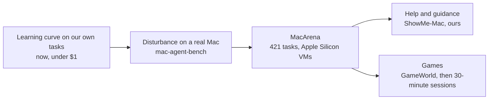
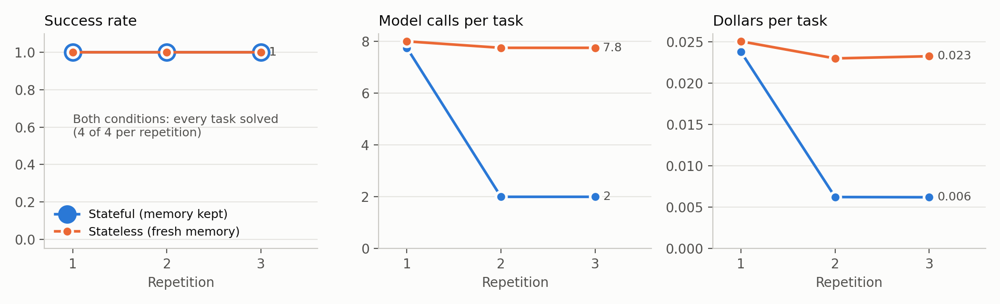

# 05 · Verdict and next benchmarks

**Verdict: the computer-use core is ready to benchmark on Mac apps that expose an accessibility tree, and to measure learning over time. It is not ready for games or canvas apps yet.** It can't see pixels it can't read through accessibility, and keys meant for a game window would have to take the user's focus.

What the verdict rests on, all measured on one Mac with Gemini 4 Argon:

| Check | Result |
|---|---|
| Calculator 23 × 19, 31 × 17, 48 × 25 | right answer each time; 48 × 25 cost $0.024 over 10 model calls |
| Two agents in parallel (Calculator and System Settings) | both finished, each in its own lane |
| Messages search, read-only | 7 matches |
| Focus changes during live runs | 0 (frontmost app sampled at 10 Hz) |
| Workspace UI end to end (`backend/scripts/ui_e2e.py`) | 12 of 12 checks |
| WhatsApp search | fails: its search field has no SetValue, and background keys don't land |

## Where to benchmark

### 1. Operating the Mac

| Benchmark | What it measures | Fit |
|---|---|---|
| [MacArena](https://github.com/MacPaw/MacArena) | 421 human-checked tasks across 50 apps, run in Apple Silicon VMs that reset each episode; an OSWorld fork | Best target: our hardware, macOS apps, accessibility tree allowed. The best published agent scores 36.7% on its 49 Mac-native tasks |
| [mac-agent-bench](https://github.com/PrithviSeran/mac-agent-bench) | success, cost, and *disturbance*: did the agent take your focus or cursor | Tests our main design claim directly. It drives tools through MCP, so it needs the MCP server (issue #5) |
| [MacAgentBench](https://github.com/JetAstra/MacAgentBench) | 676 tasks in 25 apps with partial credit per checkpoint | Partial credit shows where long tasks break |
| OSWorld-Verified | the standard Linux benchmark | Needs an adapter from our actions to its Ubuntu VM; second priority |

### 2. Getting better with practice

Our action graph already turns successful runs into replayable skills. These benchmarks test whether that memory helps:

- **CL-Bench** ([2606.05661](https://arxiv.org/abs/2606.05661)) defines the gain metric we use below.
- **PreAct** ([2606.17929](https://arxiv.org/abs/2606.17929)) compiles a first success into a state machine and replays it 8.5 to 13 times faster on OSWorld. That is close to our graph, so it is the baseline to beat.
- **Skill evolution on OSWorld** ([2609.04869](https://arxiv.org/abs/2609.04869)) gained 5.7 to 18.6 points over an empty-library control in four app domains.
- **OS-Marathon** ([2601.20650](https://arxiv.org/html/2601.20650)) tests long, repetitive workflows, where replay should pay off most.

**The gain metric.** For trial *t*, let *r*sf,t be the reward with memory carried across trials (stateful) and *r*sl,t the reward with a fresh, empty memory (stateless). Then

> *g*t = *r*sf,t − *r*sl,t, and total gain *G* = Σt *g*t.

Whatever makes a task easy or hard shows up in both terms, so *g* is what memory bought. Example: if the stateful agent solves a task and the stateless one fails, *g* = 1 − 0 = 1. If both solve it, *g* = 0, and memory can still pay off in cost: fewer model calls for the same answer. So we report steps, calls, dollars and seconds beside *G*.

### 3. Help and guidance ("where is this feature?", "what is it for?")

The closest published pieces:

- **"Where is it?"** AutoGUI-v2 FuncElemGnd ([2604.24441](https://arxiv.org/html/2604.24441)): find the element that does a described thing, among look-alikes.
- **"What does it do?"** AutoGUI-v2 FuncElemCap: predict what clicking an element does. GUI Knowledge Bench ([2510.26098](https://arxiv.org/pdf/2510.26098)) covers macOS among its six platforms.
- **Exploring an unfamiliar app.** UIExplore-Bench ([2506.17779](https://arxiv.org/pdf/2506.17779v1.pdf)).
- **"Show me, then undo it."** LegacyWorld's atomicity score: a run must finish the task or leave no side effects.

None of these scores the whole loop we want: find the feature, point at it, explain it, show it working, then put everything back. So we will build a small one, **ShowMe-Mac**: 30 prompts across built-in apps. Each prompt gets three scores:

1. **Point.** Did the cursor land on the right element? Checked against the element's accessibility id.
2. **Explain.** Is the explanation right? Checked with a FuncElemCap-style rubric.
3. **Revert.** Is the app state the same as before? An accessibility snapshot diff of 0 means yes.

The overlay already points and draws, and the graph already logs every action, so most of the parts exist.

### 4. Games

| Benchmark | Scope |
|---|---|
| [GameWorld](https://arxiv.org/html/2604.07429v1) | 34 browser games, 170 tasks, a computer-use action interface. The game pauses during inference, so the score reflects decisions, not model latency |
| [VideoGameBench](https://vgbench.com/) | 23 classic games; the goal is to finish the game |
| [LongPuzzleBench](https://arxiv.org/abs/2609.34769v1) | 114 puzzle levels; a human needs over 1,000 actions for one level |
| [PlaySuite](https://arxiv.org/html/2610.07127) | about 5,700 itch.io and PyWeek games |
| [Cradle](https://arxiv.org/html/2403.03186v1) | 40-minute missions in Red Dead Redemption 2 |
| [LOLPlay](https://arxiv.org/abs/2611.03685) | League of Legends; the best model reaches 25% |

A 30-minute game demo needs three things the agent lacks today:

- **Seeing pixels.** Games draw on a canvas with no accessibility tree, so the decide step needs a screenshot path.
- **Holding keys in real time.** Games need keys held down, not single presses.
- **Sending keys to the game window.** Today that would take the user's focus. GameWorld avoids both the focus and the timing problems by running browser games that pause while the model thinks, with keys injected in-page.

So the first game target is GameWorld. Long sessions can then reuse the graph, as OmniGameArena's improvement curve does.

## Models to compare

On every benchmark above, the same harness runs with Gemini 4 Argon (decide and verify), Gemini 4 Hydrogen, and Gemini 3.5 Flash-Lite. Flash-Lite answered in 1.29 s per decision against 3.8 s for Argon, but needed 17 decisions where Argon needed 9. Which one is cheaper per *solved* task is the question these runs answer.

## Pilot: learning curve on our own tasks

Runner: `backend/bench/learning_curve.py`. Four tasks (three Calculator sums, one System Settings pane), three repetitions, stateful and stateless runs interleaved.

**Result: memory didn't change success (G = 0, a ceiling), but from the second repetition on it cut model calls 3.9 times and cost 3.7 times.** All 24 trials succeeded. The pilot cost $0.43 and took 11.6 minutes, and the frontmost app stayed the same through all 1,355 focus samples.

Means over the four tasks. Repetitions 2 and 3 are pooled, since they match:

| Condition | Rep | Success | Calls | Dollars | Seconds | Steps replayed from memory |
|---|---|---|---|---|---|---|
| Stateful | 1 | 4/4 | 7.75 | 0.0238 | 38.3 | 0 of 5.75 |
| Stateless | 1 | 4/4 | 8.00 | 0.0251 | 37.9 | 0 |
| Stateful | 2–3 | 8/8 | 2.00 | 0.0062 | 12.8 | 5.75 of 5.75 |
| Stateless | 2–3 | 8/8 | 7.75 | 0.0232 | 36.2 | 0 |

How to read it:

- **G = Σ*g*t = 0** over 12 pairs, because every trial in both arms scored *r* = 1. These tasks are too easy to show a success gain, so the effect shows up entirely on the cost side.
- **Cost.** From repetition 2 on, the stateful agent replays every step of the stored path. It makes 2 model calls in place of 7.75 (3.9 times fewer), which cuts cost per task from $0.0232 to $0.0062 (3.7 times less) and time from 36.2 s to 12.8 s (2.8 times faster). PreAct reports 8.5 to 13 times faster replay; our remaining time goes to the two calls and to UI waits.
- **No transfer yet.** In repetition 1 the stateful agent solved 48 × 25 right after 23 × 19 with nothing replayed, because the graph keys skills to the goal it saw. Reusing a path across similar goals is the next thing to build and measure.
- **Sample size.** That's 4 tasks × 3 repetitions on one Mac, so it shows the effect is real but not how large it is in general. The next run uses tasks the agent fails sometimes (MacArena), where G can move.

Data: `backend/bench/results/argon-pilot/trials.csv` (one row per trial). The figure and its `data.csv` come from `backend/bench/plot_learning_curve.py`.
